<div align="center">

# Azeroth Survivors

**A free fan-made WoW roguelike by [Aethus](https://wow.aethus.pl/), run locally on a
from-scratch WoW 1.12.1 client engine (Rust + [Bevy](https://bevy.org)).**

[](LICENSE-MIT)

</div>

## What this fork adds

This is [maluramichael/azeroth-survivors-re](https://github.com/maluramichael/azeroth-survivors-re),
a fork of [OutThisLife/azeroth-survivors-re](https://github.com/OutThisLife/azeroth-survivors-re).
The `features` branch is upstream plus everything below. Newest first.

| Feature | What it does | Screenshot |
| --- | --- | --- |
| Co-op sees the bosses | A co-op guest now sees what the host's bosses do: the ground marks of every shape with their warning, the missiles in their school's glow, chest lids that open, rare and enraged bars, and the camps and bosses on the minimap. Old and new builds no longer join each other (protocol 2). | 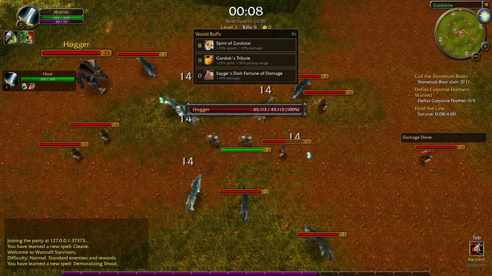 |
| Rares and the bonus boss | From the third minute a named rare may turn up (the Deadmines' lieutenants in Westfall, Princess in Elwynn), one at a time and never beside a boss. The fallen finale drops a five-rank chest and opens a portal for 20 seconds: step in for an optional bonus boss (Onyxia, Azuregos, Nefarian, Chromaggus, Gahz'ranka, Viscidus or Baron Rivendare by zone) with a fixed epic and 200 gold. The run is won either way. Some rare and item names are made up. |  |
| Drop models | What lies on the ground is a WoW model that floats and turns, no longer a see-through cylinder with a ball: crystals for experience, weapons, armour pieces and jewellery for gear (a light column from green up), a rune for a boss's heal, the shards' own looks, and four chests by source whose lid opens with a sound. Drop models carry no collision. |  |
| Guard camps | Two to four camps stand around each battleground: an elite on a short patrol and two guards, watching a locked chest or a shrine (full heal, a shield and gold). Come close or hit one and the whole camp attacks; a cleared camp returns after three minutes. Camps, bosses, rares and the portal show on the minimap, pinned to its edge when out of sight. In debug mode F4 jumps to the nearest camp. | 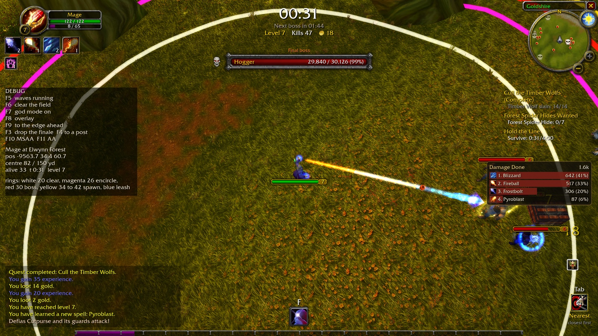 |
| Boss bar | A boss on the field gets a WoW bar at the top: name, health and percent, slides in on arrival with the raid warning sound, two at most. Rares are silver, an enraged boss orange-red, Kazzak violet with ??? for numbers; a skull shows for a boss ten levels above the character. The bar moves under the world-buff offer while that is open. | 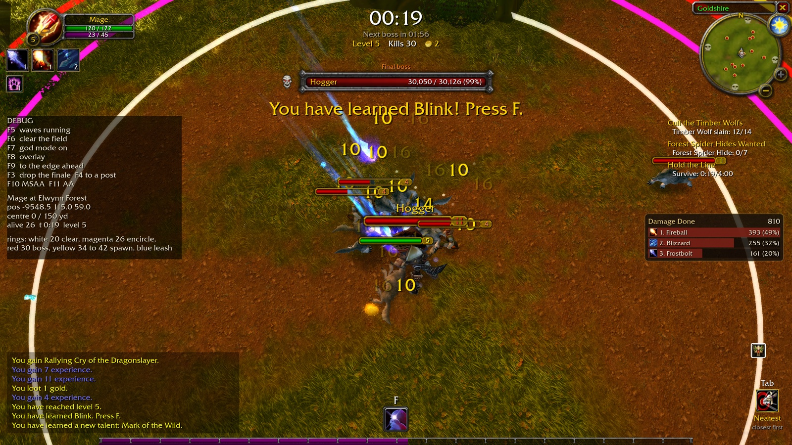 |
| Boss mechanics | Each named boss has its own kit instead of the same circle and missile ring: cones, lines, rings, charges, bombs that leave burning ground, a frenzy, adds at set health (Hogger calls gnolls at 70 and 35 %), yells, and signature loot. Every shape is marked on the ground first, 1.5 s for a circle and 2 s for the rest; the balance simulator's pilot steps out of them too. |  |
| Abandon run pays out | Abandon run on the pause screen now ends the run like a fall: the results screen comes up and the character keeps the experience and the gold earned so far. |  |
| Hit flash and corpse fade | A struck enemy lights up for a moment, a crit a little longer. The dead play their death animation, lie still a moment and sink into the ground as they fade; elites and bosses lie longer and sink deeper. Both can be switched off under Options, Graphics. | 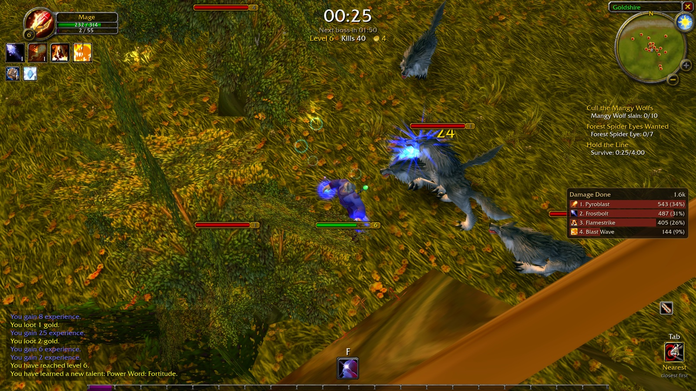 |
| Anti-aliasing and live multisampling | FXAA or SMAA on the world, and multisampling (2x to 8x) that changes while the game runs instead of after a restart. Sharpen and colour, the grade on G, is a setting with its own sharpness slider and is remembered. In debug mode F10 steps MSAA and F11 the anti-aliasing. | 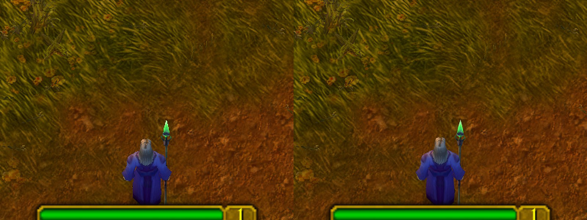 |
| Graphics options and presets | Options is split into Sound, Video, Graphics and Controls tabs. Graphics has presets (Low, Medium, High, Ultra) and rows for view distance, ground clutter, weather, spell detail, anisotropic filtering, multisampling, anti-aliasing, screen glow, the death effect, hit flashes, corpse fades and sharpening; a preset shows Custom once a row differs. | 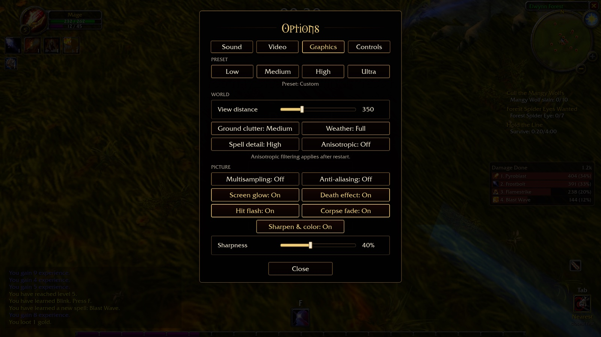 |
| Windows releases with updates | Every push to `features` builds the Windows player build on GitHub's runners and publishes a release with a Setup.exe (installs per user, no admin) and a portable zip. An installed game checks the releases at start, downloads a newer one in the background and installs it at the next start. Settings and saves live in `%APPDATA%\Warcraft Survivors`. At the first start the game offers to download the WoW 1.12.1 client data (about 5.5 GB, from the same archive.org item as `make fetch-data`, with a progress window) or to use a client the player already has. | 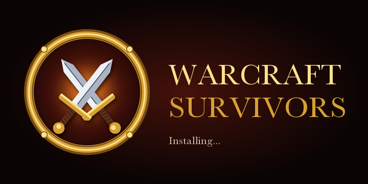 |
| Ranged enemies, boss abilities, elite affixes | Caster and archer creatures (Mystics, Geomancers, Stormers...) keep their distance and throw missiles you can step out of, from two and a half minutes on. Every boss marks a crimson circle at your feet and strikes it a moment later, or fires a ring of missiles. An elite comes Swift, Shielded or Volatile (it bursts when it dies), named on its plate. The balance simulator dodges them like a player. | 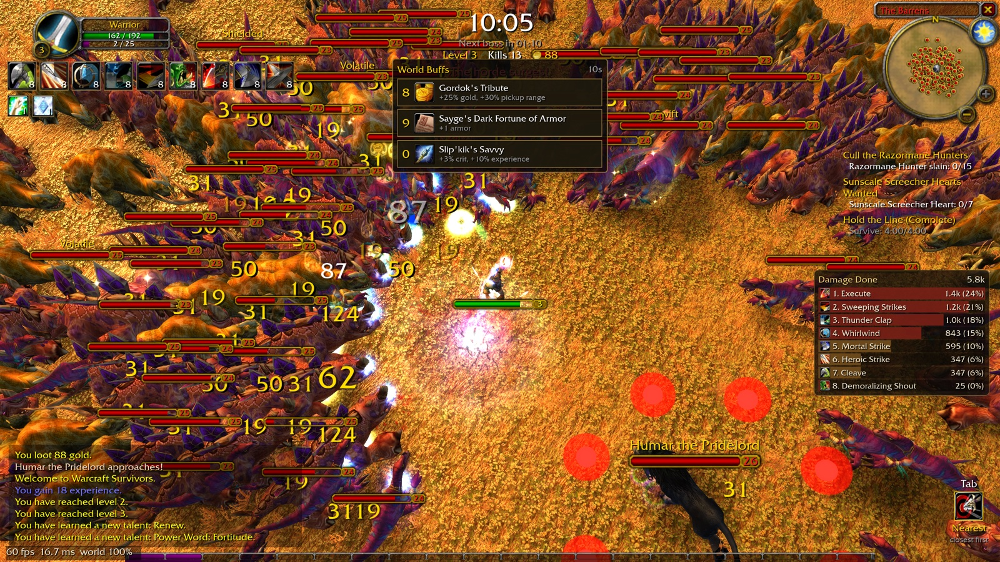 |
| Frame cap and world resolution | Options has a Performance section: a frame-rate cap (30 to 240 or off), the world's render resolution (50 to 100 %, the interface stays sharp), automatic resolution that drops a step when frames run long and climbs back when there is room, and an FPS readout in the bottom-left corner. `WOW_FPS_CAP` and `WOW_RENDER_SCALE` set them for one session. | 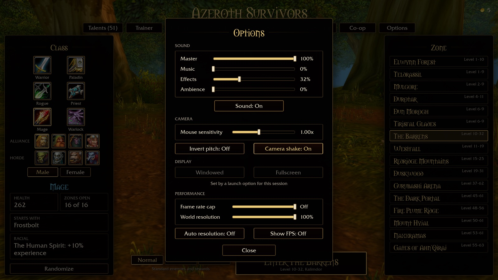 |
| Quest log | A Quest Log window on the hub. Each zone also needs a quest in the zone before it (survive ten minutes there, or beat its final boss), on top of the character's level; each locked class has a quest that opens it for free, buying it with gold still works. A done quest is announced after the run. Zones a profile could already enter stay open. | 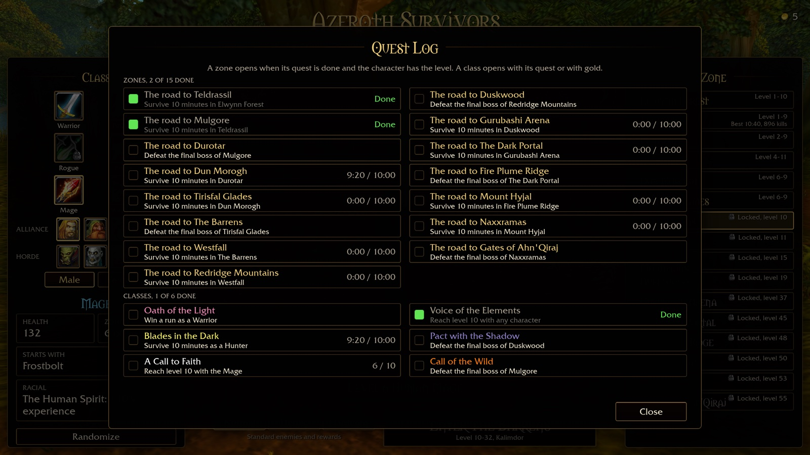 |
| Mods: own classes and spells | Classes, abilities and talents can be added as TOML files in a `mods` folder (or `--mods <dir>`), next to the built-in ones. A class can mix two pools: the example Spellblade fights with the warrior's looks and draws warrior and mage spells plus one of its own. See [docs/MODDING.md](docs/MODDING.md). | 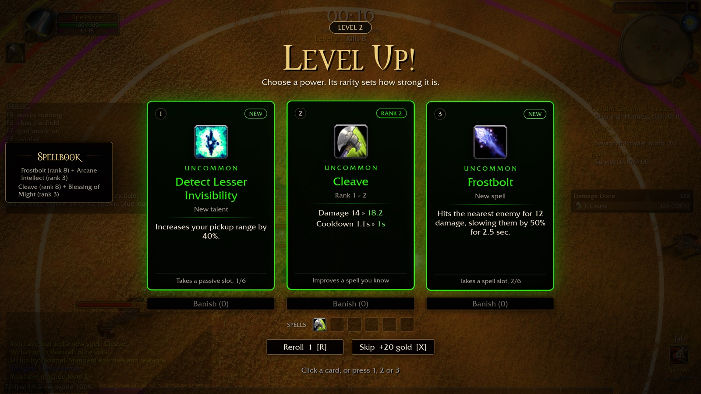 |
| Balance simulator | `cargo survivors-sim` plays every class through whole runs headless, with no window, GPU or game data, about 500 times faster than real time, and prints one line per run (result, level, kills, damage per second, damage taken, top spells) and one per class. `SIM_TRACE=1` adds each run's timeline every 30 seconds: level, spells, enemies spawned and alive, waves, surges, bosses. A test in the suite holds that timeline to the game's rhythm, so a change that breaks how a run flows fails. |  |
| Screenshot tool and test scripts | F12 saves a screenshot from inside the game. `--script "6 shot a; 7 key F9; 8 hold W 2; 12 quit"` plays keys and screenshots against a run and ends it, so a test runs and photographs itself without anyone at the keyboard or a desktop capture. `--shots <dir>` picks the folder. |  |
| Debug mode | `--debug` skips the menu into a run with the class and zone from `--class` and `--zone`, saves nothing and starts in god mode. Rings on the ground show where enemies spawn and the leash, a panel the hero's position; F5 holds the waves and the clock, F6 clears the field, F7 toggles god mode, F8 the overlay and F9 jumps to the edge. | 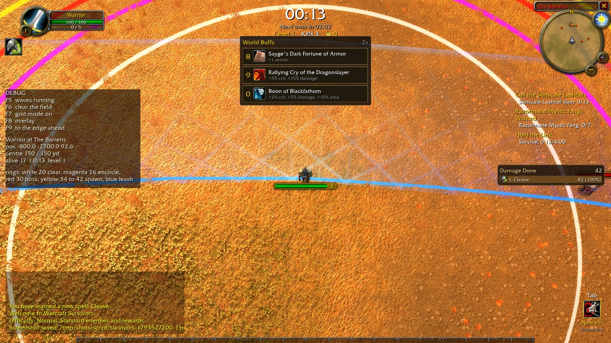 |
| More launcher flags | `--auto`, `--zone` and `--shots` start a hands-off test run with screenshots; `--no-grade`, `--dpi`, `--no-vsync`, `--farclip`, `--clutter`, `--no-sound` and `--home` cover the display and other settings that were environment variables only. The dev commands that only print a list (`WOW_CAPTURE=list`, `WOW_PROBE=list`) now run without a data folder. |  |
| Co-op, stage three | Every player picks their own level-up cards while the world keeps running (whoever is choosing is spared, a hand left open 20 seconds picks itself), brings their whole profile, and keeps their own chests, gear and gold; quests are the party's. A fallen hero lies until a friend stands beside them for three seconds; the run is lost when everyone is down. Party frames on the left show each other hero's class, name, level, health and spells, and the results list the whole party. | 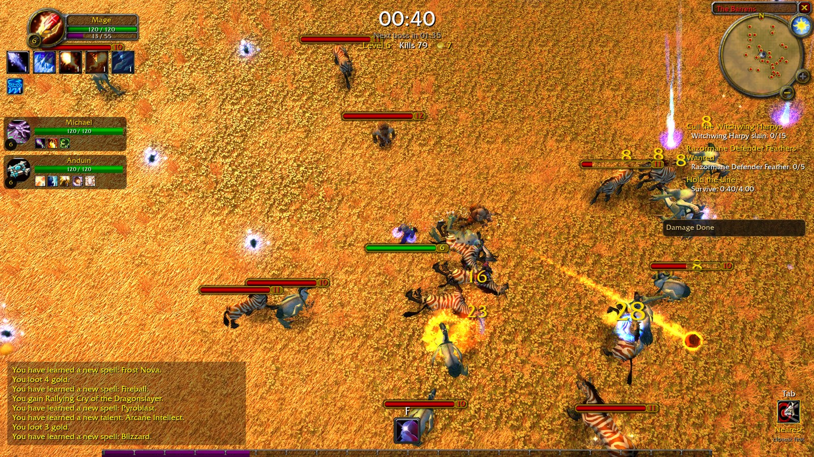 |
| Co-op, stage two | The host runs the fight for everyone: guests see the horde with its nameplates, the pickups, ground spells, totems, every cast, swing and damage number. Enemies chase and hit the nearest hero, guests included, and a guest's spells are cast on the host and kill there. More heroes bring more and tougher enemies. When the host falls, every guest sees the results and stays in the party for the next run. Guest cards, revive and shared loot come in stage three. | 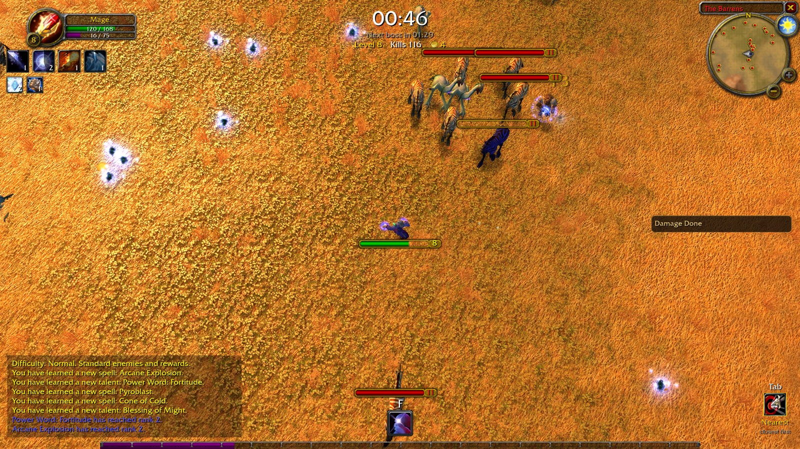 |
| Co-op window | A Co-op tab on the hub: LAN games finds parties on the local network and joins one with a click; Host opens a party (name, password, public or private, 2 to 4 players) and shows the address friends join with; Join by IP takes an address. Left a guest's LAN list, right the host. | 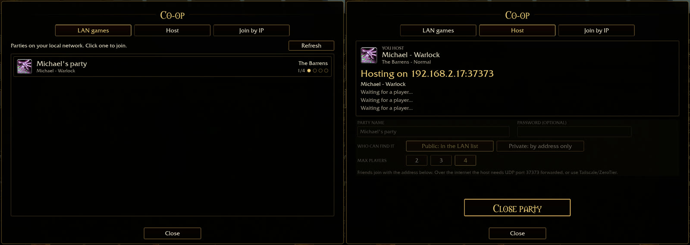 |
| Co-op, stage one | One player hosts with `--host`, friends join with `--join <ip>` (UDP 37373, up to four players, no server in between). Both walk the same battleground and see each other; enemies and fights are shared from stage two on. Tested across a LAN: left the host on a Mac, right the guest on Windows. | 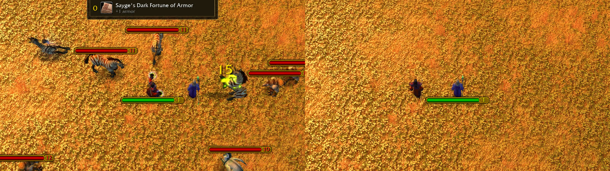 |
| Wave surges | From the first minute, every 45 seconds the horde surges for 12 seconds, with a countdown under the clock. | 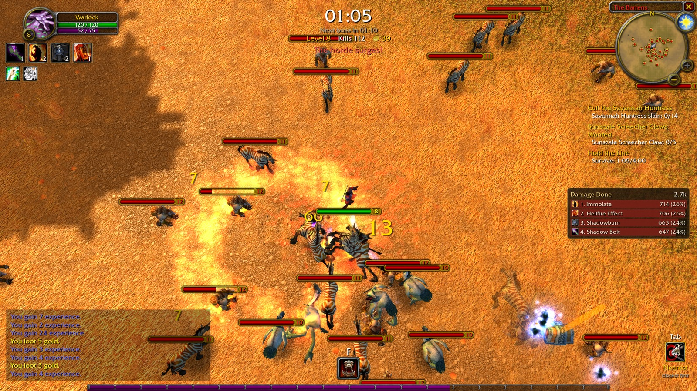 |
| Hellfire and Sweeping Strikes visuals | Aura spells now show on the hero: Hellfire's ring of fire burns around the warlock each pulse. |  |
| Best runs and racial traits | The hub shows the selected class's best time and kills under each zone, gold after a win. Each race lends a small bonus named after its racial, shown on the class panel and in the character window. | 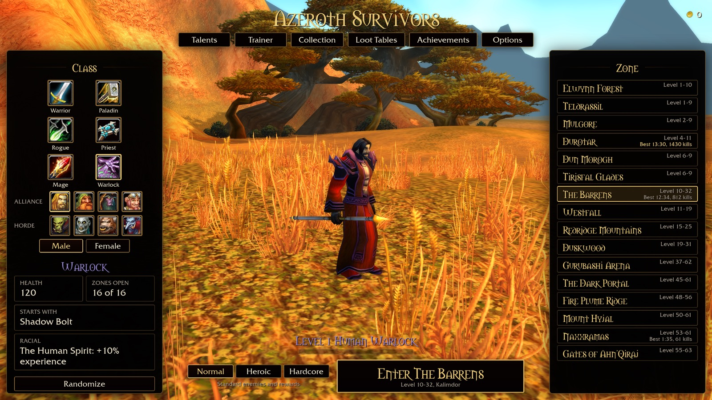 |
| Camera settings, shake and obstacles | Options has a mouse sensitivity slider and toggles for inverted pitch and camera shake. Hits shake the camera a little, and trees or buildings between camera and hero pull it in. | 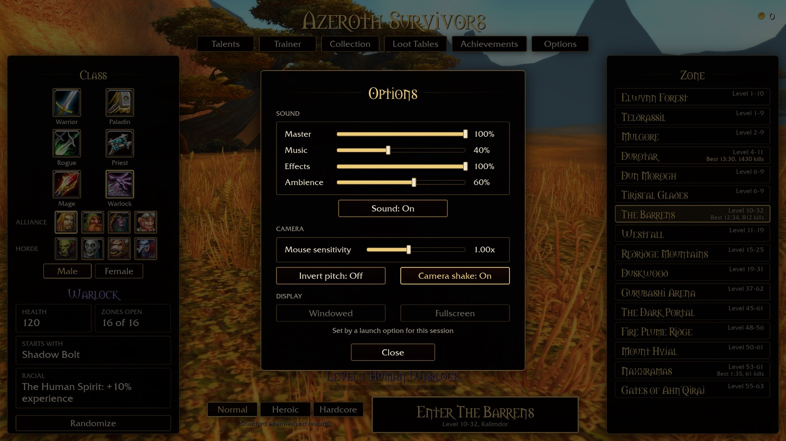 |
| Hit feedback | Direct hits knock enemies back, crits further; elites barely move and bosses not at all. |  |
| Boss enrage | A boss below 40 percent health enrages once: faster, harder hits, an emote in the chat. |  |
| Faster gems | Gems fly in faster, and a fallen boss pulls every gem on the field. |  |
| Chests clear of the hero | A chest never lands at the hero's feet, so it is not opened by accident. |  |
| Item suffixes | Green and better items are named after their stats as in Classic: of the Bear, of the Eagle, of the Owl. |  |
| Seeded runs and level-up tests | `WOW_SURVIVORS_SEED=<n>` starts every run from the same dice. Regression tests for the level-up hands, ported from upstream PR #10. |  |
| Unit frames | The hero's frame is WoW's targeting frame: a round class portrait, the name plate, health and experience bars and a level badge. The target gets the same frame, elites the elite one. | 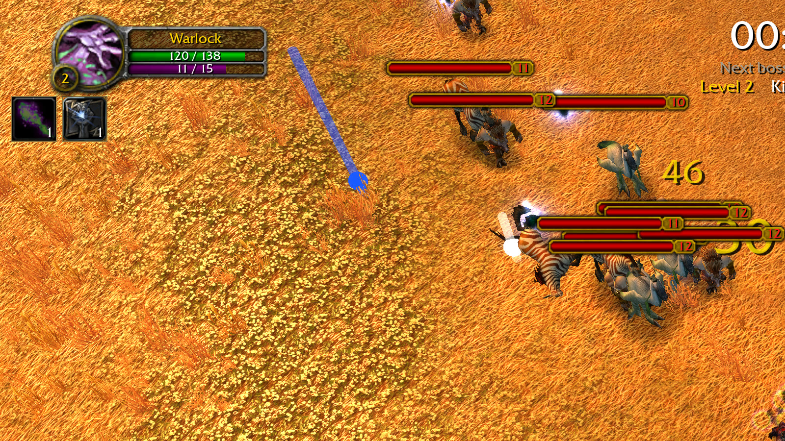 |
| Level-up perks | Under every card a Banish button takes that power out of the run; Reroll draws a new hand and Skip trades the pick for gold. The Spellbook moves to the left of the cards. | 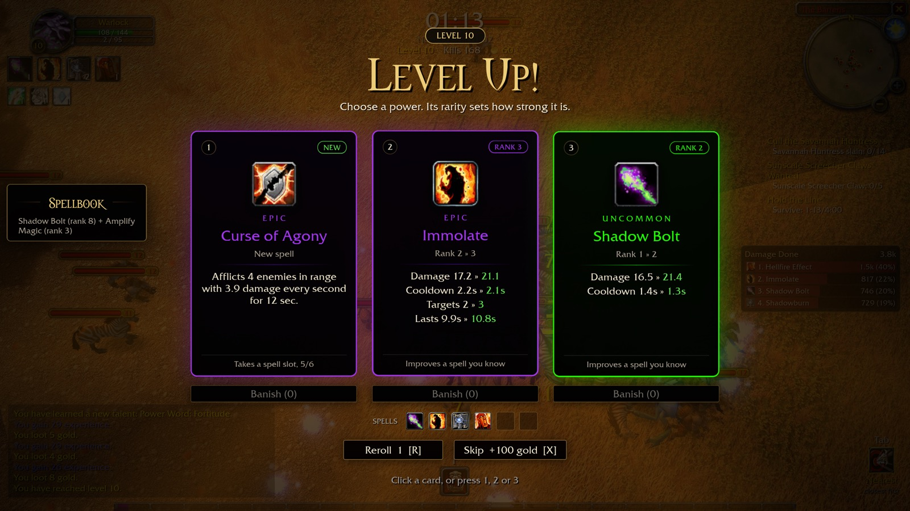 |
| Achievements | Fifty achievements over zones, classes, feats, totals and the collection, each worth points. The points buy perks: more rerolls, banishes and a four-card first hand. | 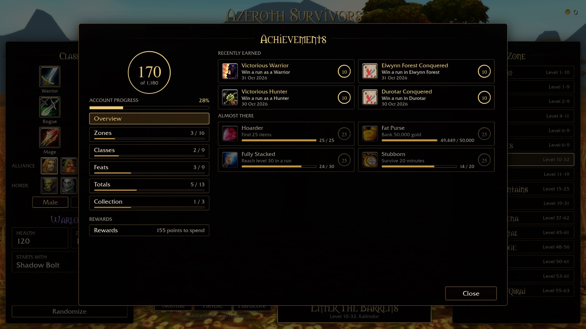 |
| Loot tables | A window per zone: its bosses with their times, the drop chances by source and quality, and the items each quality can roll. | 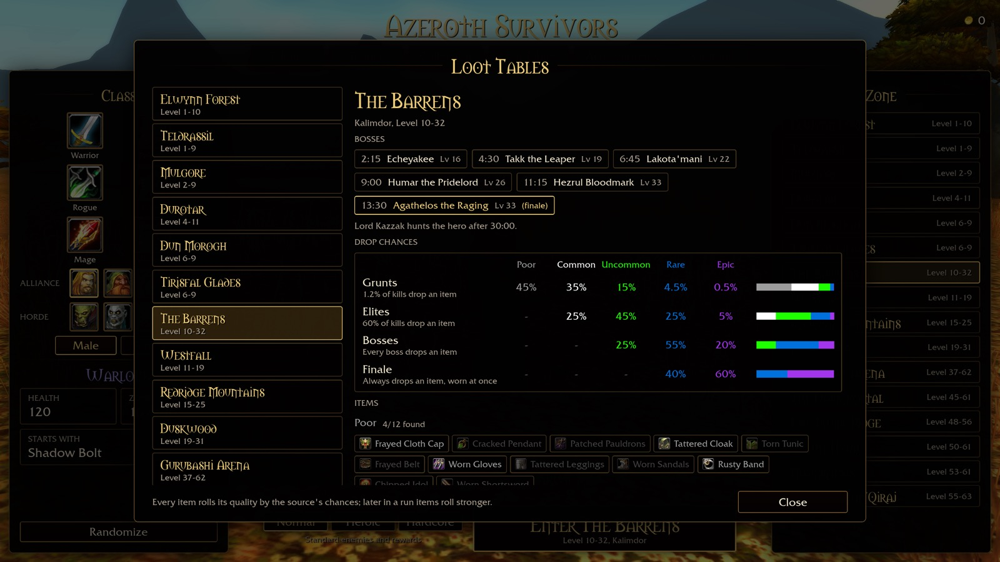 |
| Collection | A book of every item, twelve slots by five qualities. Found pieces show their icon and rolls, the rest a question mark. | 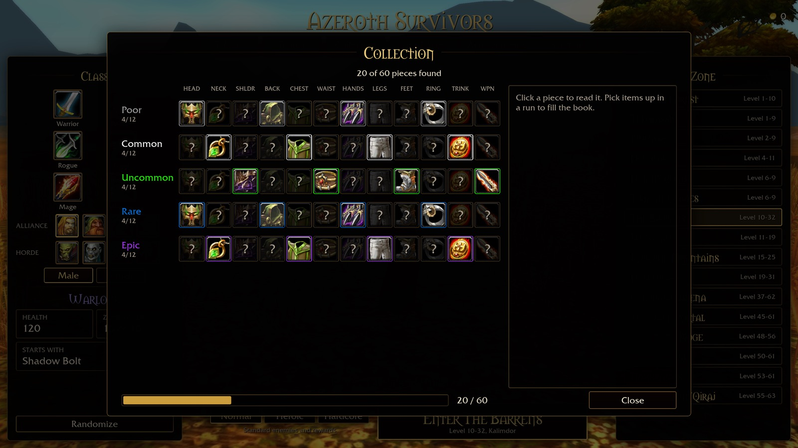 |
| Damage meter and boss countdown | A Damage Done window ranks your spells by the damage they dealt this run, with each one's share. Under the clock, "Next boss in 01:39" counts down to the next boss and then to the finale. | 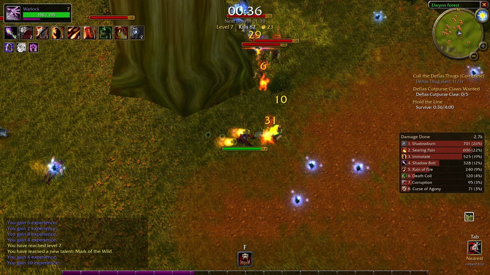 |
| Level-up cards | The level-up cards take their rarity's colour for edge, tint and glow, with a NEW, RANK or EVOLVE chip, improvements in green and the slot a card takes. The hero's spell slots sit under the cards. | 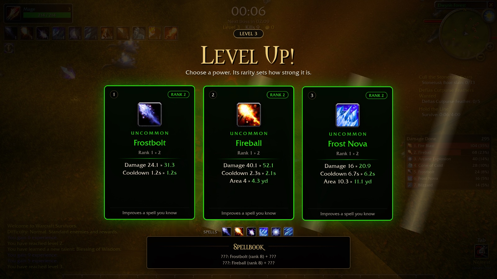 |
| Talent tree | Talents is a real tree on the class's talent frame art, with connectors between the talents, rank badges and a line that reads the talent under the mouse. | 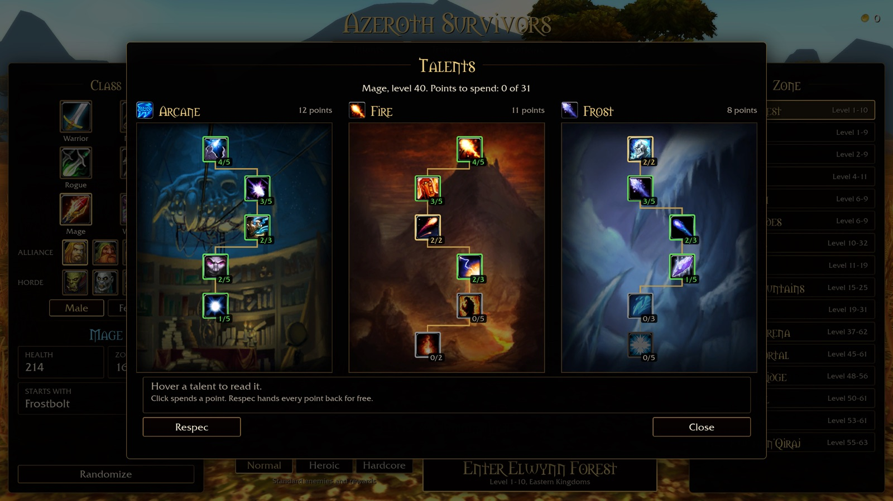 |
| Hub and window style | The pick screen is a hub: Talents, Trainer and Options as tabs under the title, the bank at the top right, a Class panel on the left, the zones on the right and a big Enter button. Every window shares one style: dark panels with a thin gold edge, Morpheus titles, dark red buttons. | 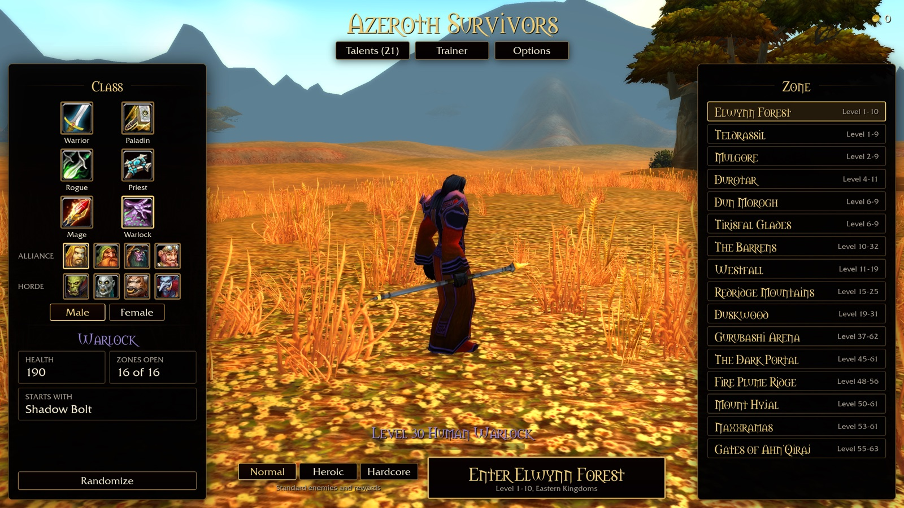 |
| Fewer log warnings | Crit numbers no longer fill the glyph sheet on a large window ("glyph sheet full ... resetting" every few seconds), and the trainer no longer asks for two textures 1.12 does not have. | |
| Faster rebuilds | The survivors mode moved out of `benilla-app` into its own crate, `crates/survivors-app`. A one-line change now builds in 2 to 4 s instead of 6 to 12 s, the whole mode in 11 s instead of minutes. | |
| Unit frames and quests | A player frame and a target frame at the top left; a left click on an enemy targets it and the abilities hit it first. Three quests a run (slay, gather drops, survive) in a tracker under the minimap, handed in for gold and experience. |  |
| Evolutions | An ability at rank 8 with its matching talent at rank 3 offers an orange **Evolution** card that turns it into a stronger spell (Frostbolt and Arcane Intellect become Glacial Volley). Found recipes stay in the spellbook on the level-up screen. |  |
| Zone finale | The zone's dungeon boss (Hogger in Elwynn Forest) comes at 13:30 and killing it wins the run. After 30 minutes Lord Kazzak hunts the hero and cannot die. |  |
| WoW pickups | Rare drops: a Hearthstone shard pulls every gem in, Divine Intervention clears the screen, Frost Nova freezes the horde. |  |
| Elites and chests | Golden elites (bigger, five times the health) and bosses drop a chest that ranks up one, three or five abilities at once. |  |
| Gear drops | The dead drop gear in WoW quality colours, lit by a beam on the ground. The best piece per slot is worn and adds its stats; the best one worn is banked and worn from the start of the next run. Shown in a strip at the right and in the character window. |  |
| World buffs | At the start and every ten minutes three world buffs are offered under the clock (Sayge's fortunes, Songflower, Spirit of Zandalar, Fengus' Ferocity and more): keys **8 / 9 / 0** or a click, the run does not pause. |  |
| Talents | From character level 10 one talent point per level, spent in three WoW specs per class (Arcane, Fire, Frost and so on). The ranks add to every run; **Respec** is free. |  |
| Difficulty | **Normal**, **Heroic** or **Hardcore** under the zone list: tougher, faster, harder-hitting enemies for x1.5 or x2.5 character experience and gold; Hardcore drops no health. Kept in the profile. |  |
| Enemies spawn in the open | Enemies no longer appear inside trees, rocks or sealed rooms: a spawn tries a fan of angles on its ring until a spot is free and joined to the hero, and one that ends up stuck is set down again. |  |
| Options window | **Options** on the pick screen and the pause screen: volume sliders for master, music, effects and ambience, sound on or off, and windowed or fullscreen. Saved in `benilla-config/config.toml`. |  |
| Chat window | Status lines at the bottom left as WoW's chat prints them: experience and gold (summed each second), level ups, new spells and talents, bosses, and the run's payout. Fades when quiet, the wheel scrolls back. |  |
| Target focus | **Tab** (or a click on the icon at the bottom right) cycles what the abilities aim at: the nearest enemy, the one with the lowest health, or the strongest (bosses first). |  |
| Enemy pathfinding | Enemies walk around trees, rocks and buildings: a walkability grid scanned from the world's colliders and a flow field toward the hero, cheap enough for hundreds of enemies. | |
| Hero collision | The hero no longer walks through trees, rocks and buildings; he stops at them and slides along, as the WoW player does. | |
| Character window | **C** opens a window with the hero's numbers as they stand: health, armor, speed, damage, attack and cast speed, crit, area, pickup range, gold, and every ability and talent with its rank. |  |
| Free camera | No more locked camera: the left and right arrows or a mouse drag turn it, WASD runs and strafes against it, so one hand moves while the other turns. | |
| Enemy levels | The level sits beside every enemy health bar, coloured as WoW colours it against your character's level. |  |
| Pick-screen camera | The camera at the pick screen turns slowly by itself, follows a left-mouse drag and zooms with the wheel; it resumes turning three seconds after the last drag. | |
| Visible barrier | The edge of the battlefield is a glowing runic wall instead of an invisible one. It brightens as you come close and flashes when it pushes you back. |  |
| Enemy health bars | Health bars over the nearest 60 enemies and every boss, toggled with **V** as in WoW. |  |
| Trainer and classes for gold | A trainer at the pick screen sells eight permanent upgrades (might, health, haste, speed, magnet, armor, regeneration, greed), fully refundable. Warrior, Hunter and Mage are free; every other class is bought with gold. |  |
| Character levels and zone locks | One character per class keeps its level across runs (1 to 60, a little more health and damage per level). A zone opens once the character reaches its lowest creature level; lower zones always stay open. The pick screen shows the level and an XP bar. |  |
| Gold | Enemies and bosses drop gold coins. The HUD counts them and the results screen shows the run's payout, which goes into a saved bank. |  |
| Launcher flags | `--data <PATH>`, `--windowed` (`-w`) and `--size WxH` for `warcraft-survivors`. Without `--data` or `WOW_DATA` it uses the checkout's `wow-data`; with no data folder at all it stops at launch and lists where it looked, instead of opening an empty world. |  |
| Rust 1.99 warning fix | `fetch_update` renamed to `try_update` in `benilla-ui`; no more deprecation warnings on Rust 1.99. | |


> **Not an original project.** *Azeroth Survivors* is a free, fan-made WoW roguelike by
> **Aethus**: play the original in the browser at **[wow.aethus.pl](https://wow.aethus.pl/)**
> ([r/wowservers announcement](https://www.reddit.com/r/wowservers/comments/1x0yidl/azeroth_survivors_roguelike_wow_singleplayer_game/)
> · [Discord](https://discord.gg/UzxaZuSAk)). This repository is a from-source local build of the
> game, running on the [benilla](#how-its-built) / [wenilla](#how-its-built) engine, for personal use.

Pick a class and a battleground, then survive: WASD to move, your abilities cast themselves,
enemies swarm in waves, you level up and pick upgrades, and a boss shows up every couple of
minutes. **No server, no login, no account**: fully offline and self-contained.

<table>
  <tr>
    <td width="50%"></td>
    <td width="50%"></td>
  </tr>
  <tr>
    <td></td>
    <td></td>
  </tr>
</table>

### In this build

- **A character-create pick screen** built from the client's own glue art: eight races, both
  genders, every class the race can be, and **sixteen zones**, from the starting zones to
  Naxxramas and the Gates of Ahn'Qiraj. Each zone fights with its own creatures and bosses, taken
  from the zone's real spawns. Your pick is remembered across reloads.
- **Level-up cards** that deal in, tilt toward the cursor and lift on hover. Their WoW item-quality
  colour says how strong a pick is, and each card lists exactly what changes, like
  `Damage 20 » 26` or `Targets 2 » 3`.
- **A class movement spell on F** from level 5, aimed at the cursor: Blink, Charge, Sprint, Dash,
  Fade, Ghost Wolf, Aspect of the Cheetah, Blessing of Freedom, Howl of Terror.
- **A free camera:** a drag with either mouse button or the left and right arrows turn it
  around the hero, as in WoW; WASD runs and strafes against it, and the wheel zooms from over
  the shoulder out to 70 yards.
- A light sharpen-and-colour pass over the picture (**G** toggles it).

## Play it

```bash
git clone https://github.com/OutThisLife/azeroth-survivors-re
cd azeroth-survivors-re
make build     # fetch game data + install toolchain + build the wasm (~5.5 GB download)
make start     # → open http://127.0.0.1:8090/
```

`make build` chains three re-runnable scripts, each skipping what's already done:

| Step | What it does |
| --- | --- |
| `scripts/fetch-data.sh` | downloads the WoW 1.12.1 client and extracts its MPQs |
| `scripts/web-setup.sh` | installs the wasm toolchain (wasi-sdk, wasm-bindgen, binaryen) |
| `scripts/web-build.sh` | builds the client into `web/dist/` |

**Prerequisites:** [Rust](https://rustup.rs/), `make`, `curl`, `unzip`, and a bash shell. On Windows, run everything from Git Bash; PowerShell and cmd can't run the scripts.

Run `make` (or `make help`) to list every target.

### Native desktop build

`make native` fetches the data and runs the desktop client. To start it yourself:

```bash
cargo run --release -p warcraft-survivors -- --windowed
cargo run --release -p warcraft-survivors -- --data /path/to/WoW --size 1280x720
```

`--data` takes the client's `Data` folder or the folder above it; without it (and without
`WOW_DATA`) the game uses the checkout's `wow-data`, where `make fetch-data` puts the client.
`--windowed` (`-w`) opens a 1600×900 window instead of borderless fullscreen, and `--size WxH`
sets the window size. Without a data folder the game stops at launch and lists where it looked.

For testing, `--debug` starts straight into a run with the hero unhurtable, the spawn rings on the
ground and debug keys (F5 to F9, see [CONTROLS.md](CONTROLS.md)); `--class <name>` and
`--zone <name or index>` pick the class and battleground. `--auto <class>[:idle|:all|:late]` plays
a run by itself, and `cargo survivors-sim` plays every class through whole runs headless for
balancing (`SIM_CLASSES`, `SIM_ZONES`, `SIM_SEEDS`, `SIM_LEVEL`, `SIM_DIFFICULTY`, `SIM_TRACE=1`;
see `crates/survivors-app/src/balance.rs`). F12 saves a screenshot into `--shots <dir>`, and `--script` plays a timeline of
keys and screenshots against the run, so a test needs nobody at the keyboard:

```bash
cargo survivors -- --debug --class warrior --zone barrens -w --shots /tmp/shots \
  --script "6 shot overlay; 8 key F9; 9 hold W 3; 12.5 shot walked; 13 quit"
```
 Display and other settings:
`--no-grade`, `--dpi <scale>`, `--no-vsync`, `--farclip <yards>`, `--clutter <density>`,
`--no-sound` and `--home <dir>`. Each flag only sets the `WOW_*` variable the game already reads,
so the variables keep working. `--help` lists every flag.

## Controls

See [CONTROLS.md](CONTROLS.md). The short version: **WASD** to run and strafe, the **left/right arrows** to turn, **Space** to jump, **F**
for your class's movement spell, the **mouse wheel** to zoom, a **mouse drag** to turn the camera, **V** for
enemy health bars, **C** for the character window, **Esc** to pause, **1/2/3** to pick a level-up card.

## The game data (not in this repo)

This repo ships **no Blizzard content**: no art, models, sounds, maps, MPQ contents, or
FrameXML. The game reads a WoW 1.12.1 client's `Data` folder at runtime, which you supply.

`make build` (via `scripts/fetch-data.sh`) downloads the **English WoW 1.12.1 (build 5875)**
client from [archive.org](https://archive.org/details/WoW_1.12.1-5875) (~5.5 GB) and extracts the
MPQs into `wow-data/Data/` (git-ignored, resumable, skipped when already present). Or point at a
client you already have with `--data` / `WOW_DATA`.

### Changing the download source

If the archive.org item moves or you have your own mirror, override the URL without editing
anything:

```bash
make build WOW_DATA_URL=https://your-mirror.example/client.zip
```

Or set it permanently by editing the single clearly-marked `DEFAULT_DATA_URL` line at the top of
`scripts/fetch-data.sh`. Either way the URL must be a direct link to a zip holding the client's
`Data/*.MPQ` files.

## How it's built

The survivors mode is `crates/survivors-app/src/`, running on two upstream projects:

- [benilla](https://github.com/samwhosung/benilla): a from-scratch WoW 1.12.1 client.
- [wenilla](https://github.com/Arnesen/wenilla): benilla compiled to WebAssembly, with a local
  host and realm service.

## Legal

*Azeroth Survivors* is a free fan game by **Aethus**, not affiliated with or endorsed by
Blizzard Entertainment, and it ships no Blizzard game files. The screenshots in `docs/screenshots/`
show World of Warcraft art rendered from a user-supplied client; that art is © Blizzard
Entertainment. World of Warcraft is a trademark of Blizzard Entertainment, Inc. The engine code in
this repository is licensed under
[MIT](LICENSE-MIT) or [Apache 2.0](LICENSE-APACHE), at your option; the vendored components under
`third_party/` keep their own upstream licenses.
