<div align="center">

# Azeroth Survivors

**A free fan-made WoW roguelike by [Aethus](https://wow.aethus.pl/), run locally on a
from-scratch WoW 1.12.1 client engine (Rust + [Bevy](https://bevy.org)).**

[](LICENSE-MIT)

</div>

## What this fork adds

This is [maluramichael/azeroth-survivors-re](https://github.com/maluramichael/azeroth-survivors-re),
a fork of [OutThisLife/azeroth-survivors-re](https://github.com/OutThisLife/azeroth-survivors-re).
The `features` branch is upstream plus everything below; each feature is also offered upstream
as its own pull request. Newest first.

| Feature | What it does | Screenshot | Upstream PR |
| --- | --- | --- | --- |
| Faster rebuilds | The survivors mode moved out of `benilla-app` into its own crate, `crates/survivors-app`. A one-line change now builds in 2 to 4 s instead of 6 to 12 s, the whole mode in 11 s instead of minutes. | | none, built on `features` |
| Unit frames and quests | A player frame and a target frame at the top left; a left click on an enemy targets it and the abilities hit it first. Three quests a run (slay, gather drops, survive) in a tracker under the minimap, handed in for gold and experience. | 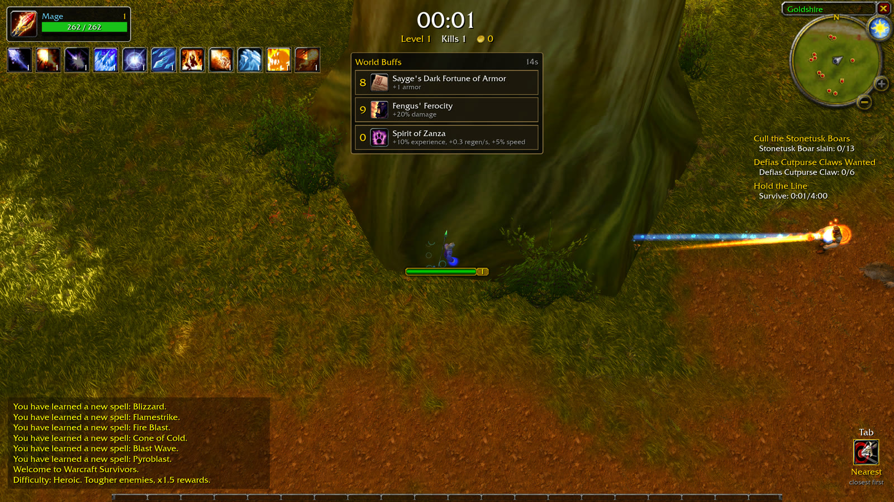 | none, built on `features` |
| Evolutions | An ability at rank 8 with its matching talent at rank 3 offers an orange **Evolution** card that turns it into a stronger spell (Frostbolt and Arcane Intellect become Glacial Volley). Found recipes stay in the spellbook on the level-up screen. | 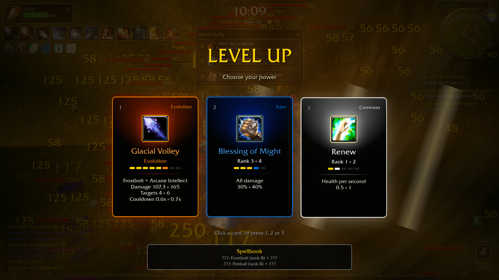 | none, built on `features` |
| Zone finale | The zone's dungeon boss (Hogger in Elwynn Forest) comes at 13:30 and killing it wins the run. After 30 minutes Lord Kazzak hunts the hero and cannot die. | 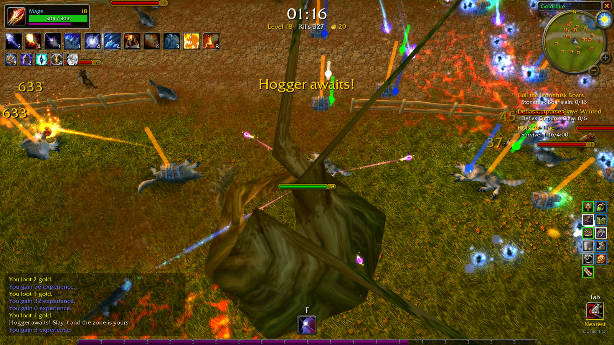 | none, built on `features` |
| WoW pickups | Rare drops: a Hearthstone shard pulls every gem in, Divine Intervention clears the screen, Frost Nova freezes the horde. |  | none, built on `features` |
| Elites and chests | Golden elites (bigger, five times the health) and bosses drop a chest that ranks up one, three or five abilities at once. | 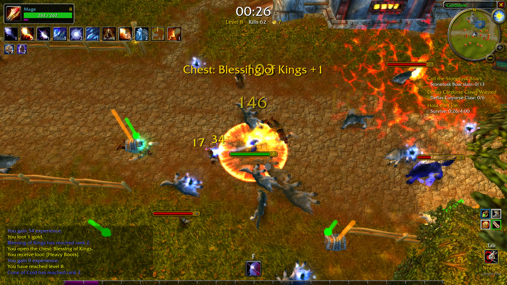 | none, built on `features` |
| Gear drops | The dead drop gear in WoW quality colours, lit by a beam on the ground. The best piece per slot is worn and adds its stats; the best one worn is banked and worn from the start of the next run. Shown in a strip at the right and in the character window. | 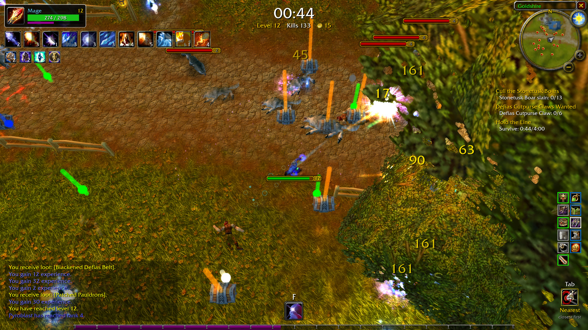 | none, built on `features` |
| World buffs | At the start and every ten minutes three world buffs are offered under the clock (Sayge's fortunes, Songflower, Spirit of Zandalar, Fengus' Ferocity and more): keys **8 / 9 / 0** or a click, the run does not pause. | 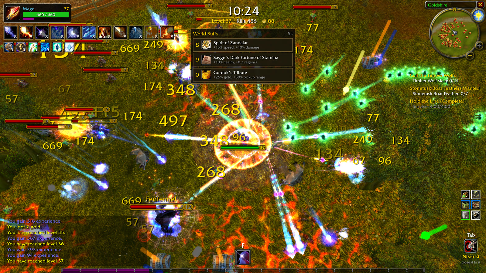 | none, built on `features` |
| Talents | From character level 10 one talent point per level, spent in three WoW specs per class (Arcane, Fire, Frost and so on). The ranks add to every run; **Respec** is free. | 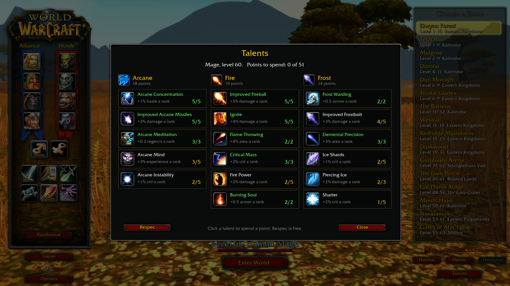 | none, built on `features` |
| Difficulty | **Normal**, **Heroic** or **Hardcore** under the zone list: tougher, faster, harder-hitting enemies for x1.5 or x2.5 character experience and gold; Hardcore drops no health. Kept in the profile. | 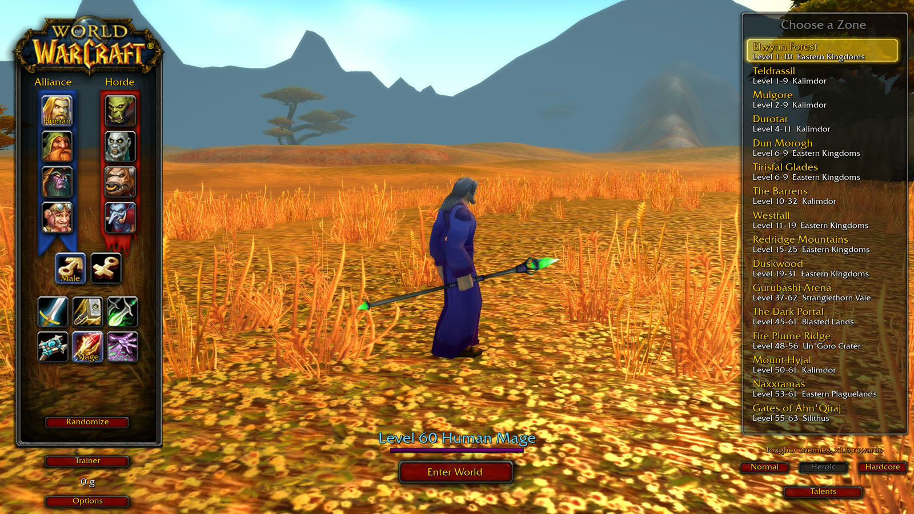 | none, built on `features` |
| Enemies spawn in the open | Enemies no longer appear inside trees, rocks or sealed rooms: a spawn tries a fan of angles on its ring until a spot is free and joined to the hero, and one that ends up stuck is set down again. |  | none, built on `features` |
| Options window | **Options** on the pick screen and the pause screen: volume sliders for master, music, effects and ambience, sound on or off, and windowed or fullscreen. Saved in `benilla-config/config.toml`. | 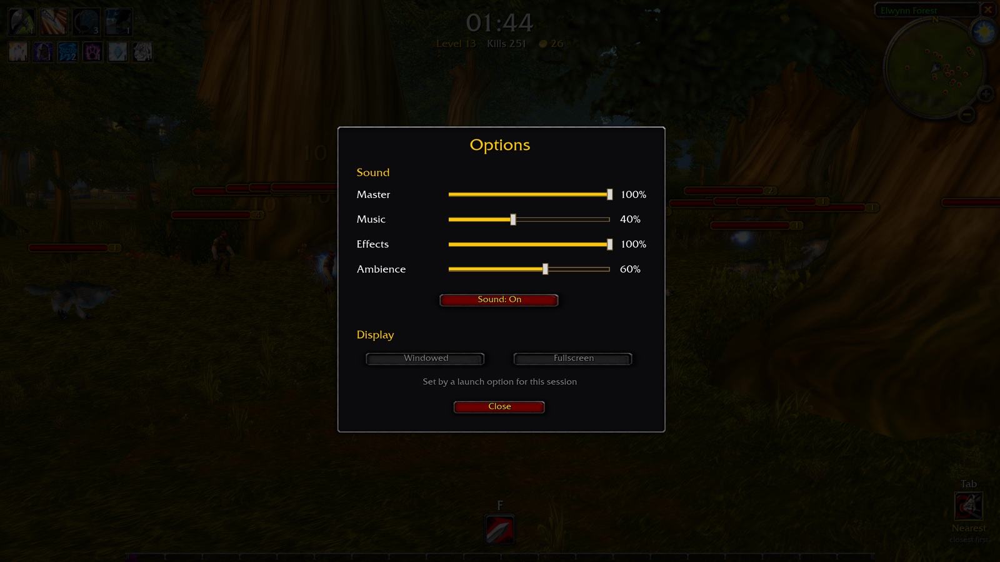 | none, built on `features` |
| Chat window | Status lines at the bottom left as WoW's chat prints them: experience and gold (summed each second), level ups, new spells and talents, bosses, and the run's payout. Fades when quiet, the wheel scrolls back. | 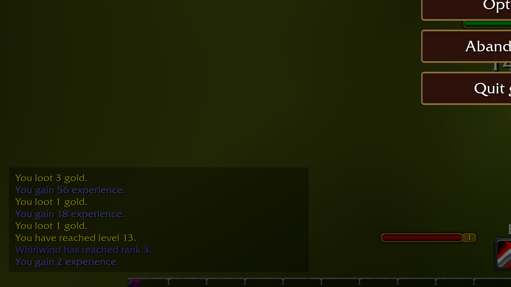 | none, built on `features` |
| Target focus | **Tab** (or a click on the icon at the bottom right) cycles what the abilities aim at: the nearest enemy, the one with the lowest health, or the strongest (bosses first). | 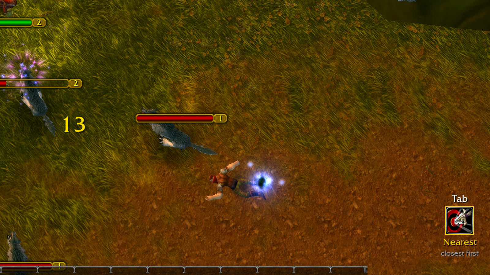 | none, built on `features` |
| Enemy pathfinding | Enemies walk around trees, rocks and buildings: a walkability grid scanned from the world's colliders and a flow field toward the hero, cheap enough for hundreds of enemies. | | none, built on `features` |
| Hero collision | The hero no longer walks through trees, rocks and buildings; he stops at them and slides along, as the WoW player does. | | none, built on `features` |
| Character window | **C** opens a window with the hero's numbers as they stand: health, armor, speed, damage, attack and cast speed, crit, area, pickup range, gold, and every ability and talent with its rank. | 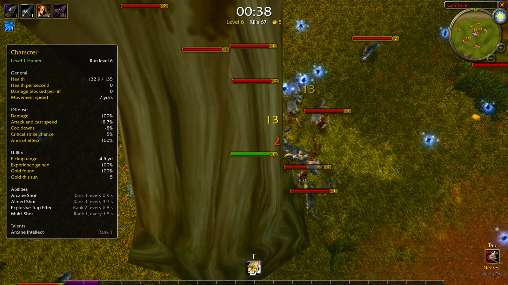 | none, built on `features` |
| Free camera | No more locked camera: the left and right arrows or a mouse drag turn it, WASD runs and strafes against it, so one hand moves while the other turns. | | none, built on `features` |
| Enemy levels | The level sits beside every enemy health bar, coloured as WoW colours it against your character's level. | 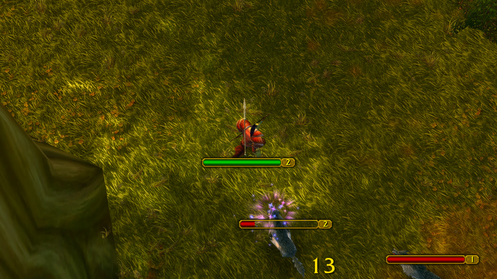 | none, built on `features` |
| Pick-screen camera | The camera at the pick screen turns slowly by itself, follows a left-mouse drag and zooms with the wheel; it resumes turning three seconds after the last drag. | | none, built on `features` |
| Visible barrier | The edge of the battlefield is a glowing runic wall instead of an invisible one. It brightens as you come close and flashes when it pushes you back. | 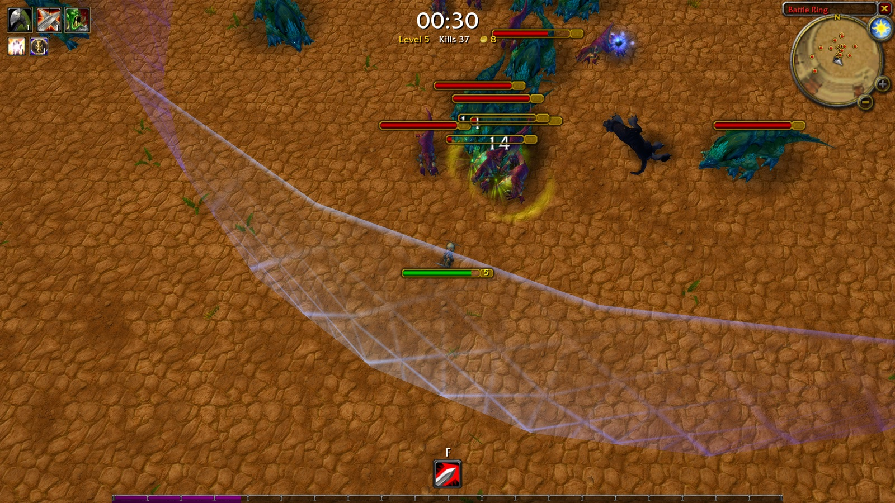 | none, built on `features` |
| Enemy health bars | Health bars over the nearest 60 enemies and every boss, toggled with **V** as in WoW. | 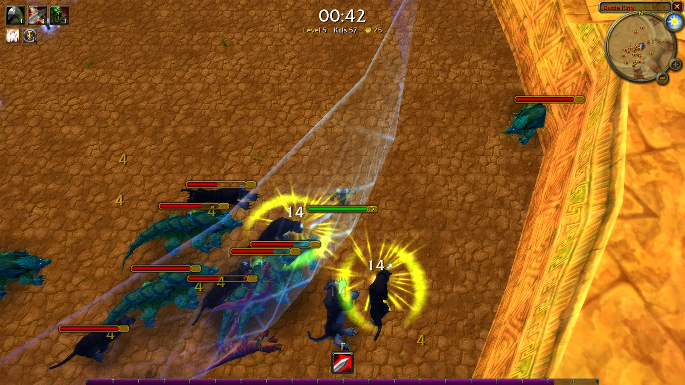 | none, built on `features` |
| Trainer and classes for gold | A trainer at the pick screen sells eight permanent upgrades (might, health, haste, speed, magnet, armor, regeneration, greed), fully refundable. Warrior, Hunter and Mage are free; every other class is bought with gold. | 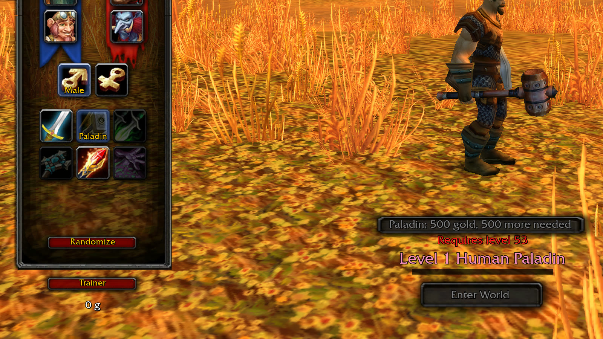 | none, built on `features` |
| Character levels and zone locks | One character per class keeps its level across runs (1 to 60, a little more health and damage per level). A zone opens once the character reaches its lowest creature level; lower zones always stay open. The pick screen shows the level and an XP bar. | 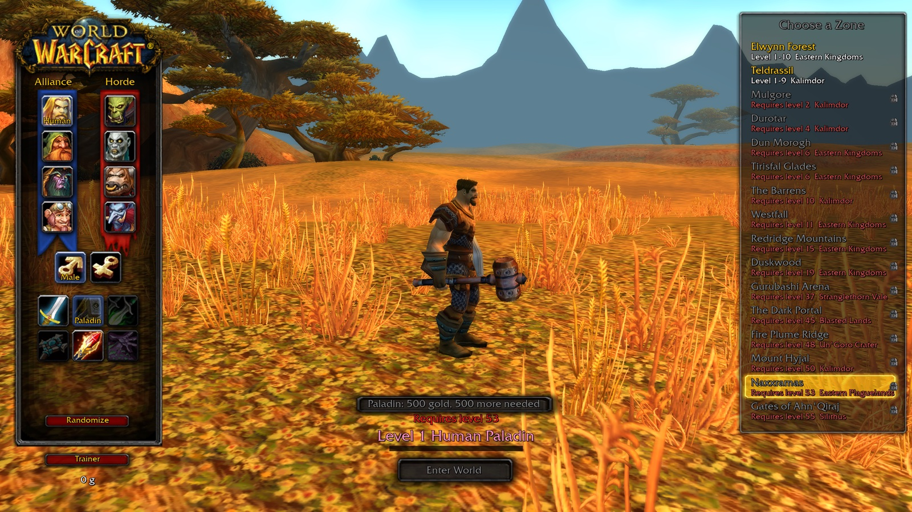 | none, built on `features` |
| Gold | Enemies and bosses drop gold coins. The HUD counts them and the results screen shows the run's payout, which goes into a saved bank. | 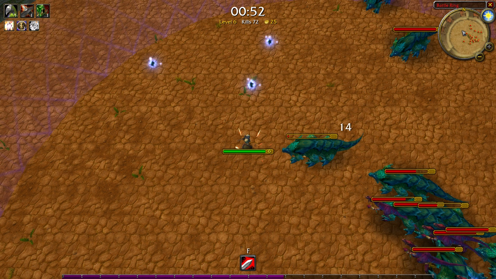 | none, built on `features` |
| Launcher flags | `--data <PATH>`, `--windowed` (`-w`) and `--size WxH` for `warcraft-survivors`. Without `--data` or `WOW_DATA` it uses the checkout's `wow-data`; with no data folder at all it stops at launch and lists where it looked, instead of opening an empty world. | 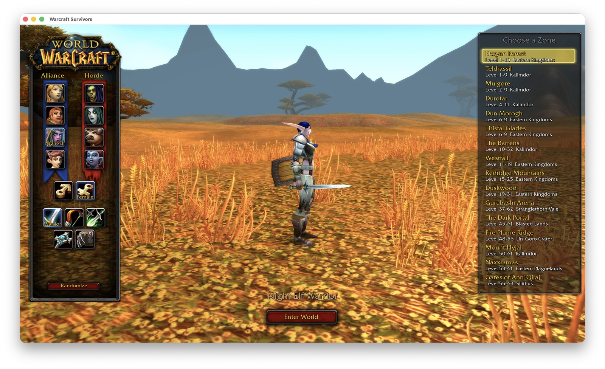 | [#19](https://github.com/OutThisLife/azeroth-survivors-re/pull/19) |
| Rust 1.99 warning fix | `fetch_update` renamed to `try_update` in `benilla-ui`; no more deprecation warnings on Rust 1.99. | | [#20](https://github.com/OutThisLife/azeroth-survivors-re/pull/20) |


> **Not an original project.** *Azeroth Survivors* is a free, fan-made WoW roguelike by
> **Aethus**: play the original in the browser at **[wow.aethus.pl](https://wow.aethus.pl/)**
> ([r/wowservers announcement](https://www.reddit.com/r/wowservers/comments/1x0yidl/azeroth_survivors_roguelike_wow_singleplayer_game/)
> · [Discord](https://discord.gg/UzxaZuSAk)). This repository is a from-source local build of the
> game, running on the [benilla](#how-its-built) / [wenilla](#how-its-built) engine, for personal use.

Pick a class and a battleground, then survive: WASD to move, your abilities cast themselves,
enemies swarm in waves, you level up and pick upgrades, and a boss shows up every couple of
minutes. **No server, no login, no account**: fully offline and self-contained.

<table>
  <tr>
    <td width="50%"></td>
    <td width="50%"></td>
  </tr>
  <tr>
    <td></td>
    <td></td>
  </tr>
</table>

### In this build

- **A character-create pick screen** built from the client's own glue art: eight races, both
  genders, every class the race can be, and **sixteen zones**, from the starting zones to
  Naxxramas and the Gates of Ahn'Qiraj. Each zone fights with its own creatures and bosses, taken
  from the zone's real spawns. Your pick is remembered across reloads.
- **Level-up cards** that deal in, tilt toward the cursor and lift on hover. Their WoW item-quality
  colour says how strong a pick is, and each card lists exactly what changes, like
  `Damage 20 » 26` or `Targets 2 » 3`.
- **A class movement spell on F** from level 5, aimed at the cursor: Blink, Charge, Sprint, Dash,
  Fade, Ghost Wolf, Aspect of the Cheetah, Blessing of Freedom, Howl of Terror.
- **A free camera:** a drag with either mouse button or the left and right arrows turn it
  around the hero, as in WoW; WASD runs and strafes against it, and the wheel zooms from over
  the shoulder out to 70 yards.
- A light sharpen-and-colour pass over the picture (**G** toggles it).

## Play it

```bash
git clone https://github.com/OutThisLife/azeroth-survivors-re
cd azeroth-survivors-re
make build     # fetch game data + install toolchain + build the wasm (~5.5 GB download)
make start     # → open http://127.0.0.1:8090/
```

`make build` chains three re-runnable scripts, each skipping what's already done:

| Step | What it does |
| --- | --- |
| `scripts/fetch-data.sh` | downloads the WoW 1.12.1 client and extracts its MPQs |
| `scripts/web-setup.sh` | installs the wasm toolchain (wasi-sdk, wasm-bindgen, binaryen) |
| `scripts/web-build.sh` | builds the client into `web/dist/` |

**Prerequisites:** [Rust](https://rustup.rs/), `make`, `curl`, `unzip`, and a bash shell. On Windows, run everything from Git Bash; PowerShell and cmd can't run the scripts.

Run `make` (or `make help`) to list every target.

### Native desktop build

`make native` fetches the data and runs the desktop client. To start it yourself:

```bash
cargo run --release -p warcraft-survivors -- --windowed
cargo run --release -p warcraft-survivors -- --data /path/to/WoW --size 1280x720
```

`--data` takes the client's `Data` folder or the folder above it; without it (and without
`WOW_DATA`) the game uses the checkout's `wow-data`, where `make fetch-data` puts the client.
`--windowed` (`-w`) opens a 1600×900 window instead of borderless fullscreen, and `--size WxH`
sets the window size. Without a data folder the game stops at launch and lists where it looked.
`--help` lists every flag.

## Controls

See [CONTROLS.md](CONTROLS.md). The short version: **WASD** to run and strafe, the **left/right arrows** to turn, **Space** to jump, **F**
for your class's movement spell, the **mouse wheel** to zoom, a **mouse drag** to turn the camera, **V** for
enemy health bars, **C** for the character window, **Esc** to pause, **1/2/3** to pick a level-up card.

## The game data (not in this repo)

This repo ships **no Blizzard content**: no art, models, sounds, maps, MPQ contents, or
FrameXML. The game reads a WoW 1.12.1 client's `Data` folder at runtime, which you supply.

`make build` (via `scripts/fetch-data.sh`) downloads the **English WoW 1.12.1 (build 5875)**
client from [archive.org](https://archive.org/details/WoW_1.12.1-5875) (~5.5 GB) and extracts the
MPQs into `wow-data/Data/` (git-ignored, resumable, skipped when already present). Or point at a
client you already have with `--data` / `WOW_DATA`.

### Changing the download source

If the archive.org item moves or you have your own mirror, override the URL without editing
anything:

```bash
make build WOW_DATA_URL=https://your-mirror.example/client.zip
```

Or set it permanently by editing the single clearly-marked `DEFAULT_DATA_URL` line at the top of
`scripts/fetch-data.sh`. Either way the URL must be a direct link to a zip holding the client's
`Data/*.MPQ` files.

## How it's built

The survivors mode is `crates/survivors-app/src/`, running on two upstream projects:

- [benilla](https://github.com/samwhosung/benilla): a from-scratch WoW 1.12.1 client.
- [wenilla](https://github.com/Arnesen/wenilla): benilla compiled to WebAssembly, with a local
  host and realm service.

## Legal

*Azeroth Survivors* is a free fan game by **Aethus**, not affiliated with or endorsed by
Blizzard Entertainment, and it ships no Blizzard game files. The screenshots in `docs/screenshots/`
show World of Warcraft art rendered from a user-supplied client; that art is © Blizzard
Entertainment. World of Warcraft is a trademark of Blizzard Entertainment, Inc. The engine code in
this repository is licensed under
[MIT](LICENSE-MIT) or [Apache 2.0](LICENSE-APACHE), at your option; the vendored components under
`third_party/` keep their own upstream licenses.
